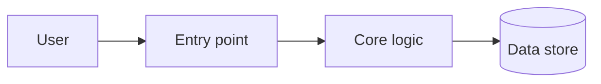

# Architecture

<!-- Remove instructional comments when filling. Describe current behavior only so a newcomer can predict where a change belongs and what it might break. Point to code files instead of copying fields, versions, signatures, or config values. Offload superseded designs, dated changelogs, and rejected trials to a separate cold file (`decisions/` or `*-history.md`)—use a trailing `## History (cold)` section only when layout is fixed to one file—and drop single-task verification receipts rather than archiving them. -->

## The big picture

<!-- Tell the story of one typical request or command from start to finish. Then add a diagram if it helps. -->

## Parts and what they own

<!-- For each part: its job, the state it owns, where its code lives, and what it must never do. -->

## Key flows

<!-- Concise current end-to-end paths and invariants they preserve—not step-by-step code walkthroughs or chronological changelogs. -->

## Failure and recovery

<!-- What can fail, what the system does about it, what the user sees, and what is safe to retry. -->

## Boundaries

<!-- Trust boundaries, external services, and the contracts that other parts or other systems rely on. -->

### Temporary workarounds

<!-- Delete if none. For each active workaround or compatibility shim: why it exists and the established condition that allows removing it (state if undecided). -->
