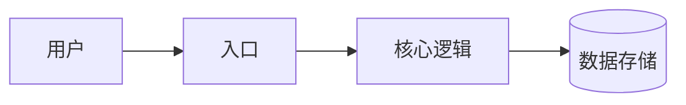

# 架构

<!-- 填写后删除模板提示注释。只描述当前生效架构，让新人能判断改动该落哪里、可能碰坏什么。字段、版本号、函数签名、配置值写明所在文件即可，不要抄录。被替代方案、按日演进日志与否决试跑默认迁入独立冷文件（`decisions/` 或 `*-history.md`）——仅在布局固定为单文件时才用末尾 `## 历史记录（冷读）`——并直接删除单次任务的验证回执，无需归档。 -->

## 全景

<!-- 先把一次典型请求或命令从头到尾讲一遍，需要的话再配一张图。 -->

## 组成部分及其职责

<!-- 每个部分写：它负责什么、掌管哪些状态、代码在哪里、绝对不能做什么。 -->

## 关键流程

<!-- 简明写出当前端到端路径与守住的边界，不写逐行代码复述或按日期追加的变更日志。 -->

## 失败与恢复

<!-- 哪里可能出错、系统怎么应对、用户看到什么、哪些操作可以安全重试。 -->

## 边界

<!-- 信任边界、外部服务，以及其他部分或其他系统依赖的契约。 -->

### 临时绕行

<!-- 没有则整节删除。每条活跃绕行或兼容垫片写明：存在原因，以及已定下的移除条件（未定则明写未定）。 -->
